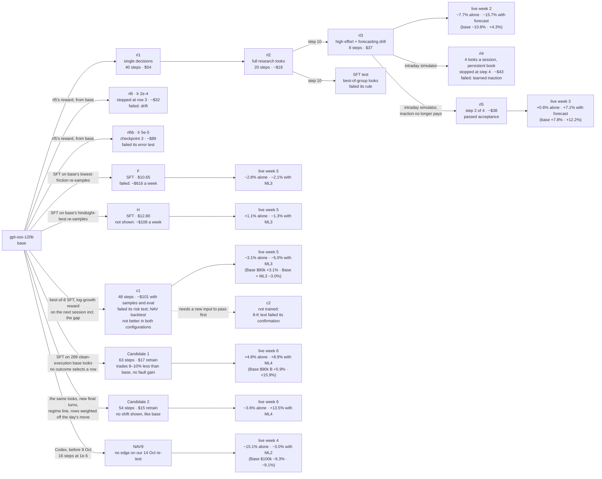

# Can we train GPT-OSS-120B to beat the market?

We are training **gpt-oss-120b**, OpenAI's open-weight model, into a specialized autonomous trader. It picks the symbol, side, size, price, order type, timing and exits on its own, and software places exactly what it decides. We train it with reinforcement learning on [Tinker](https://thinkingmachines.ai/tinker/). We build machine-learning forecast models for it to use. Every week we test the result live on an **Interactive Brokers paper account**, with real prices and simulated money, against two simple alternatives: holding cash and holding SPY.

Our target is +200% a year (CAGR) on NAV, after costs. We publish here what we train, what works and what fails. The work is done by a small team of AI agents for Clayton, who sets the goals and budgets.

*Last updated 21 November 2026, for week 6.*

## Live results: week 6 (16–20 Nov)

Ten sleeves. No software exposure limit: orders go to IBKR as the models write them, under IBKR's own margin (from Wed 18 Nov the gpt-oss sleeves are told to keep gross at or under 3x their own NAV). Base + ML4 carries its book from 26 Oct and ends its four-week run. Base runs on two prompt texts (A, the frozen control, and B), and two new trained checkpoints, Candidate 1 and Candidate 2, run at $90,000 beside it, each with and without the ML4 forecast tool. Claude Fable 5.2 runs as a reference at $30,000. Values at Friday's close, net of commissions, from each sleeve's own fills.

| Sleeve | Model | Week | Change |
|---|---|---:|---:|
| Base + ML4 $90k | gpt-oss-120b, untrained, text B | **+15.90%** | +$14,312 |
| Candidate 2 + ML4 | gpt-oss-120b + candidate 2 LoRA (SFT), $90k | +13.47% | +$12,119 |
| Candidate 1 + ML4 | gpt-oss-120b + candidate 1 LoRA (SFT), $90k | +8.86% | +$7,978 |
| Base + ML4 | gpt-oss-120b, untrained; book carried from 26 Oct ($29,424 on 13 Nov) | +8.45% | +$2,488 |
| Base $90k (B) | gpt-oss-120b, untrained, text B | +5.87% | +$5,284 |
| Candidate 1 | gpt-oss-120b + candidate 1 LoRA (SFT), $90k | +4.79% | +$4,309 |
| Fable 5.2 + ML4 | Claude Fable 5.2 (reference), $30k | +3.13% | +$940 |
| Base $90k (A) | gpt-oss-120b, untrained, text A (control) | +0.85% | +$765 |
| Fable 5.2 | Claude Fable 5.2 (reference), $30k | −1.88% | −$565 |
| Candidate 2 | gpt-oss-120b + candidate 2 LoRA (SFT), $90k | −3.57% | −$3,216 |
| **SPY** (bought at the 13 Nov mark) | | −7.97% | −$7,173 per $90k |
| **Goal** (+200% a year, weekly pace) | | +2.14% | +$1,926 per $90k |
| **Cash** | | 0.00% | $0 |

Every sleeve beat SPY in a week it fell on all five days, and seven reached the goal, mostly from net-short books at about 3x gross through Friday's 3.55% fall; Base + ML4 ends its four weeks at +6.37% against SPY −8.74%. Both trained candidates trailed untrained base on the same text in all four comparisons (by 1.1 and 9.4 points without the tool, 7.0 and 2.4 with it), so training still hasn't shown a better live trader than base. Details: [week 6](reports/2026-11-20-week6.md) · [week 5](reports/2026-11-13-week5.md) · [week 4](reports/2026-11-06-week4.md) · [week 3](reports/2026-10-30-week3.md) · [week 2](reports/2026-10-23-week2.md) · [week 1](reports/2026-10-16-week1.md).

## The models we train

### Trading policies: gpt-oss-120b checkpoints

| Checkpoint | What it learns from | In simulation (held-out dates) | Live |
|---|---|---|---|
| **rl1**, step 30 | One trading decision a day from a market table | The starting point for rl2 | Week 1: −4.79% (base −3.86%) |
| **rl2**, step 10 | A whole look: research tool calls, then orders and notes | +0.36 reward points against rl1 (t 0.78) | Not deployed; step 20 collapsed its research |
| **SFT test** | Fine-tuned on rl2's best look in each group | Failed its pre-registered rule | Not deployed |
| **rl3**, step 8 | Looks at high reasoning effort with news, plus calibrated fill and win probabilities | Passed its rule against rl2, but only by producing fewer malformed answers | Week 2: −7.74% alone, −15.71% with the forecast tool (base −10.80% / +4.32%). Its trained fill probabilities were less accurate live than base's (Brier 0.107 against 0.080). Retired |
| **rl4** | Intraday simulator: four looks in one session, with a book, resting orders and notes that persist | Drift guard stopped it at step 4: looks with no orders rose from 8.6% to 18.2%. No checkpoint | Not deployed |
| **rl5**, step 2 | rl4's simulator, with an empty look charged what an active look pays in penalties | Passed the hard criteria against base (one after a blind audit). Intraday P&L +0.20 R against base, better on 17 of 24 held-out dates (reported, not a gate). Leaves more positions unprotected overnight (98% against 74%) | Week 3: +0.63% alone, +7.09% with the forecast tool (base +7.83% / +12.20%). Protective orders on 3% of held positions against base's 13% |
| **rl6** | rl5's simulator and reward, trained from base at learning rate 2e-4 | Drift guard stopped it at row 3: token orders, then empty looks (19% to 40%). No checkpoint | Not deployed |
| **rl6b**, checkpoint 3 | The same at 5e-5 | Near base, but fails the error test: unprotected promised stops and unresearched entries more than 2 points above base's bound | Not deployed |
| **F** (loss study, 2 Nov) | SFT from base on its own re-samples of a look's final turn, the lowest-friction one | 15 held-out weeks against base + free turn: −$616 a week on $30k (90%: −962 to −273). Failed | Week 5 (Clayton's choice): −2.81% alone, −2.10% with ML3 (Base $90k +3.12%, Base + ML3 −2.98%) |
| **H** (loss study, 2 Nov) | SFT from base on the hindsight-best re-sample | −$108 a week (−510 to +279). Not shown | Week 5: +1.06% alone, −1.26% with ML3 |
| **NAV9** (Codex) | Codex's recipe from base, 16 steps at 1e-5 | Our 14 Oct re-test: no measurable edge over base (−0.03 points, p 0.93); on live looks it sits about where an untrained LoRA does | Week 4: −15.12% alone, −3.00% with ML2 (Base $100k −6.31% / −9.08%; the pairs differ in size). Not run in week 5 |
| **c1** (9 Nov) | Best-of-8 SFT from base: 408 live states from weeks 1–4, each sample scored by log growth on the next session's whole-book path, net of costs and including the overnight gap; 383 targets, 48 steps | Do-no-harm bar on 210 held-out live looks of 4–6 Nov: failed A4(a), less single-shock risk than base. Closed-loop NAV backtest: c1 − base −0.48 points; c1 + ML2 − base + ML2 +1.41 (p 0.052); needed both, so not passed | Week 5 (Clayton's choice): −3.08% alone, −4.95% with ML3 |
| **c2** | c1 trained further for stock picks, once a new input passes | Not trained: its gate, the 8-K text input, failed its confirmation | — |
| **Candidate 1** (14–15 Nov) | SFT from base on 289 whole live looks of weeks 3–5 picked by execution rules (no fill, price or P&L selects a row); retrained in the Week 6 text, 63 steps | Mechanics read on 393 held-out looks: works. Against base sampled fresh: 8% fewer orders, 10% less entry notional (p 0.01), no fault gain (11.4% against 12.6%). Simulator: −1.73% a week | Week 6 (Clayton's choice): +4.79% alone, +8.86% with ML4 (Base $90k B +5.87%, Base + ML4 $90k +15.90%) |
| **Candidate 2** (14–15 Nov) | The same looks with three declared shifts: a VIX/QQQ regime line, rows weighted so the book doesn't follow the day's move, new final turns base wrote on the Week 6 prompt; 54 steps | Works; neither shift shows (it followed the market more on down days in its first read); against fresh base nothing differs beyond chance. Simulator: +0.84% a week (−1.57 to +3.26) | Week 6: −3.57% alone, +13.47% with ML4 |
| **Candidate 3a** (21 Nov) | A week 7 candidate on the plain text: 262 rows from 519 base drafts on 125 states | Training | — |

**How we train.** GRPO on LoRA adapters, in point-in-time simulators where every research tool answers as of the decision time.
- **rl1–rl3 (daily simulator):** one pre-open decision, rewarded on what it earns over the next 10 sessions after selling everything, minus a beta-matched SPY hedge, with a charge for idle cash and a risk penalty for concentration.
- **rl4–rl6 (intraday simulator, from 24 Oct):** the live episode shape. An inherited book, then four looks in one session at 09:00, 10:30, 13:00 and 15:30, with the live prompt, state renderer and tools served from 30-minute bars. Positions are marked at the close and carried to the Monday reset; the reward charges concentration, idiosyncratic risk and unprotected overnight carry, and penalises rejected orders, malformed answers and unresearched orders.

Every test is pre-registered: the metric, the baseline and the pass rule, before looking. Since 24 October a separate Model Performance Analyst writes the acceptance criteria, a Trading Model Researcher trains, and Trader Training verifies before anything goes live. [Training report, rl1–rl3](reports/2026-10-18-training-rl1-to-rl3.md) · [rl4 and rl5](reports/2026-10-25-week3-setup.md) · [rl6, rl6b and the earnings-drift test](reports/2026-10-30-week3.md).

### Forecast models: what the trader can look up

About twenty classical ML models were built and tested out of sample, January 2025 to October 2026, each against a simple baseline and checked by an independent auditor agent.

| | Built and tested | Passed and shipped |
|---|---:|---:|
| **Direction** (which way a stock moves) | 7 families | **0**: none beat trading costs |
| **Risk and cost** (how far it moves, what a trade costs) | about 15 | **6**: next-session range (with an earnings-filing correction), move size, 20-day volatility, in-session range, SPY volatility, trading cost |
| **Same models, names outside the 523** (added 21 Oct) | scored on demand from IBKR data | Stocks: 79% range coverage against an 80% target, so shipped with a warning. Bond, credit and FX ETFs failed at 38–40% |
| **Bond, credit and FX recalibration** (24 Oct) | pre-registered, out of sample | Treasury 79.7%, credit 80.2%, FX 80.2% coverage against the 80% target: **shipped for week 3**, with a dollar-move line per order |
| **Earnings drift** (F8, 25 Oct): follow the first reaction to an earnings 8-K for two sessions | one fixed rule, 1,821 events, pre-registered | **Failed**: gross drift −9 bps, hit rate 49.6%, net of costs −23 to −27 bps, negative in every half-year |
| **Earnings-surprise drift** (SD1, 2 Nov) | one fixed rule, 2,281 events, pre-registered | **Failed**: gross −5.1 bps, net −19 to −23 bps, 2 of 7 half-years above zero |
| **ML2.1** (2 Nov), a revision of ML2 | corrected 8-K filing times, dated earnings-calendar rows | **Shipped** to every "+ ML2" sleeve |
| **ML2.2** (9 Nov), a revision of ML2 | macro releases show the same day once posted, not two sessions late | **Shipped** to every ML2 sleeve |
| **ML3.0** (9 Nov): **gap1**, tonight's overnight gap per name (quantile regression), plus SPY's move since the close | pre-registered on 241,993 name-nights, Jan 2025–Nov 2026 | Pre-registered test **failed** (coverage 76.5% against 77–83%); a walk-forward refit chosen afterwards passes (78.7%, pinball 7% below a naive band). Registered by Clayton for the "+ ML3" sleeves; forward check on 9–20 Nov nights. An intraday market line failed and isn't shown |
| **Base gpt-oss as a probability source** (Kelly v0, 9 Nov) | 49 windows × 41 names, 4 draws, Jul 2024–Jun 2025 | **No information**: AUC 0.497; a Kelly engine on it lost 29% against SPY +13% |
| **ML4.0 / ML4.1** (16–17 Nov) | ML3.1's numbers with a third of the description (1,033 tokens against 3,580), the track record on request, absr1 at or below zero replaced | Equal to ML3.1 on 710 recorded calls; no model retrained | **Shipped** to every sleeve with the tool. What the shorter text does to trading isn't measured |
| **ML4 direction models** (14–15 Nov): tabular and sequence, next look to the close or the next session | walk-forward, against a placebo | **Failed**: AUC 0.47–0.51; the sequence model's 0.55 on one target is matched by a placebo with no name information (market timing) |
| **New inputs for it** (Kelly v1 screen, 9–11 Nov): implied vol, spreads, earnings timing, industry moves, a broad universe, ML numbers, 8-K press-release text | pre-registered, two stages, plus a confirmation | **None passed**. The 8-K text's training-block AUC of 0.541 fell to 0.498 on Jul–Dec 2025 |

The models that passed form one research tool, `forecast`, which the "+ ML" sleeves can call. Comparing each sleeve with its twin measures whether the tool helps: in week 2 two of three "+ ML1" sleeves beat their twins (base by 15.1 points, Opus by 11.2) and one trailed (rl3, by 8.0); in week 3 all three did (base by 4.4, rl5 by 6.5, Opus by 5.1); in week 4 three of four did (Sonnet by 5.4, Haiku by 1.9, NAV9 by 12.1) and the $100k base pair trailed by 2.8; in week 5, with ML3, one of four did (F by 0.7) and three trailed (Base $90k by 7.3, c1 by 1.9, H by 2.3); in week 6, with ML4, all four did (base by 10.0, Candidate 1 by 4.1, Candidate 2 by 17.0, Fable by 5.0), and in every week 6 pair the sleeve with the tool carried the more net-short book into Friday's fall. That is 13 of 18 pairs, and 4 of 5 weeks on average. A verified attribution of the base pair does not credit the tool for those gaps: they come mostly from exposure, timing and single trades, and the tool's sizing and cost numbers were rarely used as intended ([week 3](reports/2026-10-30-week3.md)). Paired replays of the same live states, with the tool's output shown or masked, credited it with no final order; once, it sent the model to a stock's news more often ([week 4](reports/2026-11-06-week4.md)). [ML research report](reports/2026-10-19-ml-forecast-tool.md).

### What we train next

1. **Week 7 candidates, this weekend (Clayton's $200):** train base to trade better from IBKR data, one candidate per perspective. Candidate 3a is training; the instructions for 3b–3d failed their gate and are being rewritten for the scanner turns, where the choice of what to trade is made.
2. **New models in the lineup:** four Inkling-2-Small sleeves (Thinking Machines, through Tinker's OpenAI-compatible endpoint), and a base $30k sleeve with a next-look fact sentence that base used in 15% of drafts against 1% (W1, met).
3. **Training on base's own looks hasn't beaten base:** F, H, c1 and now Candidates 1 and 2. Each trades like base in its read, and each trailed base live.
4. **Score ML3's gap-band forward check** on the 9–20 Nov nights, and keep the live comparison running. A live week gives about 70 looks per sleeve; detecting a 0.36-point edge per decision needs more than 1,300.

## Findings so far

1. **Training has not yet produced a better trader than the untrained model.** Each RL run passed or nearly passed its simulation test, but the gains were small and statistically weak, and two SFT models trained on base's own samples (F, H) didn't beat it in simulation. Live, rl1 trailed base in week 1, rl3 split its two comparisons in week 2 (+3.1 points alone, −20.0 with the forecast tool), rl5 trailed in both in week 3 (−7.2 and −5.1), Codex's NAV9 split in week 4 (−8.8 and +6.1, against $100k base sleeves), in week 5 c1, F and H all trailed Base $90k without the tool (by 2.1 to 6.2 points), while with ML3 F and H led Base + ML3 and c1 trailed, and in week 6 Candidates 1 and 2 trailed base on the same text in all four comparisons (by 1.1 to 9.4 points). c1, trained on a log-growth reward, built the same book as base in a closed-loop backtest.
2. **Direction is not predictable after costs with the models we tried. Risk and cost are.** Option-implied volatility and earnings-filing timing carry most of the forecastable information. An earnings-drift rule, tested on 1,821 events, showed no drift at all, and an earnings-surprise rule on 2,281 events failed too. Base gpt-oss's own probability that a stock beats the median carries no information (AUC 0.497), and none of seven new inputs, earnings press-release text included, passed a pre-registered screen. The ML4 direction models (tabular and sequence) failed too: their one apparent signal was market timing, matched by a placebo.
3. **Measuring trading skill takes far more data than it seems.** Two live days, or a few hundred simulated decisions, prove nothing either way.
4. **Setup changes behaviour as much as training does.** Opus sat almost still in week 1. In week 2, with looks every 30 minutes and maximum reasoning effort, it placed 218 orders, took concentrated positions and shorts, and lost 8.8%. With the forecast tool it placed 149 orders and made 2.4%.
5. **Losses come from exposure, concentration and leverage; costs are a steady drag.** Week 2's commissions were $62–$153 a sleeve; the four losing sleeves lost $2,300–$4,700, much of it in a few names held on borrowed cash. In week 4 the gpt-oss sleeves shared one semiconductor-short stance and lost on it together; in week 6, with no software limit, net-short books at about 3x gross won up to 16% in a week SPY fell 8%, and on Monday the shared account's leverage brought an IBKR margin liquidation. Commission and half-spread cost Base + ML about $359 a week at $30k, 56% of the goal's weekly pace.
6. **The "+ ML" sleeves have led their twins more often than not, but not visibly because of the tool.** They beat their twins in eight of ten pairs over weeks 2 to 4 and one of four in week 5 (ML3, a new version), and replays of the same states credited the tool with no final order. Week 2's Base + ML1 result (+$1,296) is one AMD dip-buy (+$862) plus an NVDA paper fill $481 better than its limit; week 3's base gap is mostly exposure and timing. Within the noise between identical runs, this is suggestive, not established.
7. **RL on our reward drifts toward inaction.** Four runs, from rl3 and from base, at two learning rates, all hit their inaction or token-order guards within four updates. **Rider, 3 Nov:** in rl6 and rl6b the rise in empty looks came from looks at the research limit, under a forced submit with no reasoning turn that we removed on 1 Nov; in rl4 about half did. Below the limit, empties stayed at or under 9%. No RL has run since that change ([NAV study](reports/2026-11-02-nav-study.md)).
8. **Plumbing failures cost real results.** A gateway cutoff lost fills twice, a desktop-app update broke two Opus looks, and a stale gateway view turned an account reset into 30 orphan positions. Each was found, fixed and reported; the Gateway now runs on New York time, which removes the cutoff. On 5 November a 3-for-1 SOXX split wasn't booked, and four sleeves traded a day on wrong share counts until it was fixed. On 2 November we also found that a closing turn ending in the wrong token was thrown away and rewritten with no reasoning turn, which changed 4 of 338 gpt-oss decisions from 26 October; it's fixed ([NAV study](reports/2026-11-02-nav-study.md)). On 9 November we found that the Claude CLI had cut the forecast tool's description to 4,096 characters for every Claude "+ ML" look in weeks 2–4, so those sleeves read less of it than their gpt-oss twins; and on 10 November an automatic Windows restart cost every sleeve three looks ([week 5](reports/2026-11-13-week5.md)).

## How the live test works

- **A look.** Every 30 minutes from 09:00 to 15:30 New York time, each sleeve's model reads its positions and a market table, researches with tools, then submits orders and notes for its next look. The tools are quotes, news headlines and full articles, a stock scanner, the market tape, stats, and for "+ ML" sleeves the forecast tool. gpt-oss runs on Tinker with native tool calls. Claude runs headless through the Claude CLI with exactly the same tools over MCP.
- **Sleeves.** Every order carries a reference tying it to one sleeve, so each fill, commission and position belongs to exactly one model. Each sleeve is valued at 4:15 pm from its own fills.
- **Limits.** Through week 5 software refused orders past 2× gross per sleeve and, in week 5, past a 15% single-shock loss. From 16 Nov software sets no exposure limit: orders go to IBKR as the model writes them, and IBKR's own margin and order rules apply to the whole paper account. From 18 Nov each gpt-oss sleeve is told to keep its gross at or under 3x its own NAV; nothing enforces it. Limits the model puts on its own orders (an order marked as a close may not add to the position) are held.

All code is in [code/](code/README.md).

## Team

| Who | What they do |
|---|---|
| **Clayton** | Sets goals and budgets; decides anything public and any move to live money. |
| **Trader Training** (Claude Opus 5.5) | Runs the live paper test and the trading platform, verifies models before they go live, and publishes this page. Trained rl1–rl3. |
| **Trading Model Researcher** (Claude; Fable 5.2 in week 6) | The trainer: designs, pre-registers and trains the models and decides what they are told: rl4–rl6b, c1, Candidates 1–3, the forecast-tool versions. |
| **Model Performance Analyst** (Claude, retired 10 Nov) | Wrote acceptance criteria and ran the NAV, loss (F, H) and win/loss studies. |
| **TWS Gateway Owner** (Claude) | Runs IB Gateway and the broker framework: client IDs, quotes, orders, executions, account resets, and diagnosing execution problems such as the lost-fill cutoff. [Its own write-up](reports/tws-gateway.md). |

The Tinker Owner task looks after the Tinker SDK and checkpoint storage.

## Before this: the Codex attempt

From July to 9 October 2026 an earlier agent, Codex, worked on the same goal. Its NAV4 checkpoint made the first model-chosen paper round trip (3 TSLA shares). Our 14 October re-test on 228 new episodes found that neither NAV4 nor NAV9 traded measurably better than the base model or than holding a passive basket. That work, its code, releases and our audit are preserved in [codex/](codex/README.md). The original releases (NAV6–NAV9) are unchanged. [What Codex did against Opus and Fable, and how far each checkpoint actually moved from base on live looks](reports/2026-11-02-nav-study.md): NAV9's movement is small but separated from zero.

## What is not here

No market data, news text, broker account records, API keys, checkpoint training states or model reasoning traces are published. Prices and news come from Interactive Brokers, SEC EDGAR, FRED and other providers under their own terms. No open-source licence has been chosen yet, so ask before reusing the code.
