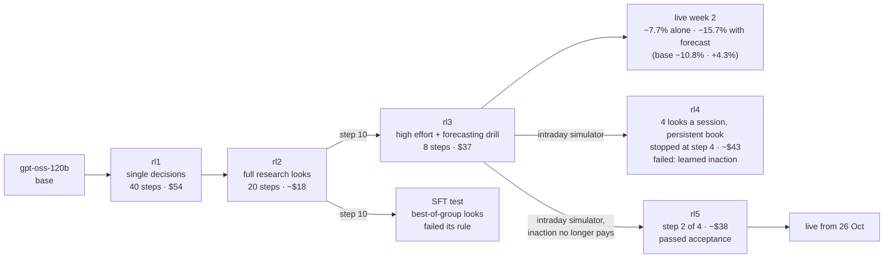

# Can we train GPT-OSS-120B to beat the market?

We are training **gpt-oss-120b**, OpenAI's open-weight model, into a specialized autonomous trader. It picks the symbol, side, size, price, order type, timing and exits on its own, and software places exactly what it decides. We train it with reinforcement learning on [Tinker](https://thinkingmachines.ai/tinker/). We build machine-learning forecast models for it to use. Every week we test the result live on an **Interactive Brokers paper account**, with real prices and simulated money, against two simple alternatives: holding cash and holding SPY.

Our target is +200% a year (CAGR) on NAV, after costs. We publish here what we train, what works and what fails. The work is done by a small team of AI agents for Clayton, who sets the goals and budgets.

*Last updated 25 October 2026.*

## Week 3 starts Monday 26 October

Six fresh $30,000 sleeves: the untrained base model, our new checkpoint **rl5** (trained this weekend on the live intraday episode shape), and Claude Opus 5.5, each alone and with the forecast tool. rl3 is retired. Its successor rl4 failed in training; rl5 passed its acceptance criteria. [Week 3 setup](reports/2026-10-25-week3-setup.md).

## Live results: week 2 (19–23 Oct)

Six sleeves of $30,000 each: three models, each run alone and with our ML forecast tool. Values at Friday's close, net of commissions, from each sleeve's own fills (matched to IBKR's 710 executions).

| Sleeve | Model | Week | Change |
|---|---|---:|---:|
| Base + forecast | gpt-oss-120b, untrained | **+4.32%** | +$1,296 |
| Opus + forecast | Claude Opus 5.5 (reference) | **+2.42%** | +$727 |
| rl3 | gpt-oss-120b + our LoRA, step 8 | −7.74% | −$2,321 |
| Opus | Claude Opus 5.5 (reference) | −8.80% | −$2,641 |
| Base | gpt-oss-120b, untrained | −10.80% | −$3,240 |
| rl3 + forecast | gpt-oss-120b + our LoRA, step 8 | −15.71% | −$4,713 |
| **Goal** (+200% a year, weekly pace) | | **+2.14%** | +$642 |
| **SPY** (bought at the 16 Oct close) | | −0.42% | −$127 |
| **Cash** | | 0.00% | $0 |

Two sleeves, both with the forecast tool, beat SPY, cash and the goal; the other four lost 7.7–15.7%. Our trained model rl3 beat the untrained base alone (−7.74% against −10.80%) but trailed it badly with the tool (−15.71% against +4.32%), so after two weeks training has not yet produced a better live trader than the base model; one week cannot settle either comparison. Details: [week 2](reports/2026-10-23-week2.md) · [week 1](reports/2026-10-16-week1.md), in which all three traders lost money.

## The models we train

### Trading policies: gpt-oss-120b checkpoints

| Checkpoint | What it learns from | In simulation (held-out dates) | Live |
|---|---|---|---|
| **rl1**, step 30 | One trading decision a day from a market table | The starting point for rl2 | Week 1: −4.79% (base −3.86%) |
| **rl2**, step 10 | A whole look: research tool calls, then orders and notes | +0.36 reward points against rl1 (t 0.78) | Not deployed; step 20 collapsed its research |
| **SFT test** | Fine-tuned on rl2's best look in each group | Failed its pre-registered rule | Not deployed |
| **rl3**, step 8 | Looks at high reasoning effort with news, plus calibrated fill and win probabilities | Passed its rule against rl2, but only by producing fewer malformed answers | Week 2: −7.74% alone, −15.71% with the forecast tool (base −10.80% / +4.32%). Its trained fill probabilities were less accurate live than base's (Brier 0.107 against 0.080). Retired |
| **rl4** | Intraday simulator: four looks in one session, with a book, resting orders and notes that persist | Drift guard stopped it at step 4: looks with no orders rose from 8.6% to 18.2%. No checkpoint | Not deployed |
| **rl5**, step 2 | rl4's simulator, with an empty look charged what an active look pays in penalties | Passed the hard criteria against base (one after a blind audit). Intraday P&L +0.20 R against base, better on 17 of 24 held-out dates (reported, not a gate). Leaves more positions unprotected overnight (98% against 74%) | Week 3, from 26 Oct |

**How we train.** GRPO on LoRA adapters, in point-in-time simulators where every research tool answers as of the decision time.
- **rl1–rl3 (daily simulator):** one pre-open decision, rewarded on what it earns over the next 10 sessions after selling everything, minus a beta-matched SPY hedge, with a charge for idle cash and a risk penalty for concentration.
- **rl4–rl5 (intraday simulator, from 24 Oct):** the live episode shape. An inherited book, then four looks in one session at 09:00, 10:30, 13:00 and 15:30, with the live prompt, state renderer and tools served from 30-minute bars. Positions are marked at the close and carried to the Monday reset; the reward charges concentration, idiosyncratic risk and unprotected overnight carry, and penalises rejected orders, malformed answers and unresearched orders.

Every test is pre-registered: the metric, the baseline and the pass rule, before looking. Since 24 October a separate Model Performance Analyst writes the acceptance criteria, a Trading Model Researcher trains, and Trader Training verifies before anything goes live. [Training report, rl1–rl3](reports/2026-10-18-training-rl1-to-rl3.md) · [rl4 and rl5](reports/2026-10-25-week3-setup.md).

### Forecast models: what the trader can look up

About twenty classical ML models were built and tested out of sample, January 2025 to October 2026, each against a simple baseline and checked by an independent auditor agent.

| | Built and tested | Passed and shipped |
|---|---:|---:|
| **Direction** (which way a stock moves) | 7 families | **0**: none beat trading costs |
| **Risk and cost** (how far it moves, what a trade costs) | about 15 | **6**: next-session range (with an earnings-filing correction), move size, 20-day volatility, in-session range, SPY volatility, trading cost |
| **Same models, names outside the 523** (added 21 Oct) | scored on demand from IBKR data | Stocks: 79% range coverage against an 80% target, so shipped with a warning. Bond, credit and FX ETFs failed at 38–40% |
| **Bond, credit and FX recalibration** (24 Oct) | pre-registered, out of sample | Treasury 79.7%, credit 80.2%, FX 80.2% coverage against the 80% target: **shipped for week 3**, with a dollar-move line per order |

The six that passed form one research tool, `forecast`, which the "+ forecast" sleeves can call. Comparing each sleeve with its twin measures whether the tool helps: in week 2 two of three "+ forecast" sleeves beat their twins (base by 15.1 points, Opus by 11.2) and one trailed (rl3, by 8.0). [ML research report](reports/2026-10-19-ml-forecast-tool.md).

### What we train next

1. **Judge rl5 live against base** in week 3, and watch what training flagged: unprotected overnight carries, orders under $1,000, and drift toward inaction.
2. **Make RL stable past a few steps.** rl4 and rl5 both drifted toward inaction within four steps; the reward's penalties still outweigh its trading signal.
3. **Close the remaining simulator gaps:** names outside the 523 have no simulator data, and rl5 + forecast trained on the forecast text from before this week's fixes.
4. **Evaluate with enough data to see an edge.** Detecting a 0.36-point edge per decision needs more than 1,300 decisions per model. A live week gives about 70 looks per sleeve.

## Findings so far

1. **Training has not yet produced a better trader than the untrained model.** Each run passed or nearly passed its simulation test, but the gains were small and statistically weak. Live, rl1 trailed base in week 1, and rl3 split its two comparisons in week 2 (+3.1 points alone, −20.0 with the forecast tool).
2. **Direction is not predictable after costs with the models we tried. Risk and cost are.** Option-implied volatility and earnings-filing timing carry most of the forecastable information.
3. **Measuring trading skill takes far more data than it seems.** Two live days, or a few hundred simulated decisions, prove nothing either way.
4. **Setup changes behaviour as much as training does.** Opus sat almost still in week 1. In week 2, with looks every 30 minutes and maximum reasoning effort, it placed 218 orders, took concentrated positions and shorts, and lost 8.8%. With the forecast tool it placed 149 orders and made 2.4%.
5. **Losses come from concentration and leverage, not costs.** Week 2's commissions were $62–$153 a sleeve; the four losing sleeves lost $2,300–$4,700, much of it in a few names held on borrowed cash.
6. **Plumbing failures cost real results.** A gateway cutoff lost fills twice, a desktop-app update broke two Opus looks, and a stale gateway view turned an account reset into 30 orphan positions. Each was found, fixed and reported; the Gateway now runs on New York time, which removes the cutoff.

## How the live test works

- **A look.** Every 30 minutes from 09:00 to 15:30 New York time, each sleeve's model reads its positions and a market table, researches with tools, then submits orders and notes for its next look. The tools are quotes, news headlines and full articles, a stock scanner, the market tape, stats, and for "+ forecast" sleeves the forecast tool. gpt-oss runs on Tinker with native tool calls. Claude runs headless through the Claude CLI with exactly the same tools over MCP.
- **Sleeves.** Every order carries a reference tying it to one sleeve, so each fill, commission and position belongs to exactly one model. Each sleeve is valued at 4:15 pm from its own fills.
- **The only fixed limit** is the broker's 2× gross margin per sleeve, rejected at order time.

All code is in [code/](code/README.md).

## Team

| Who | What they do |
|---|---|
| **Clayton** | Sets goals and budgets; decides anything public and any move to live money. |
| **Trader Training** (Claude Opus 5.5) | Runs the live paper test, verifies models before they go live, and publishes this page. Trained rl1–rl3. |
| **Trading Model Researcher** (Claude) | Designs, pre-registers and trains the models since 24 Oct: rl4, rl5 and the week-3 forecast fixes. |
| **Model Performance Analyst** (Claude) | Analyses each live week and writes the acceptance criteria a model must pass, before its results. |
| **TWS Gateway Owner** (Claude) | Runs IB Gateway and the broker framework: client IDs, quotes, orders, executions, account resets, and diagnosing execution problems such as the lost-fill cutoff. [Its own write-up](reports/tws-gateway.md). |

The Tinker Owner task looks after the Tinker SDK and checkpoint storage.

## Before this: the Codex attempt

From July to 9 October 2026 an earlier agent, Codex, worked on the same goal. Its NAV4 checkpoint made the first model-chosen paper round trip (3 TSLA shares). Our 14 October re-test on 228 new episodes found that neither NAV4 nor NAV9 traded measurably better than the base model or than holding a passive basket. That work, its code, releases and our audit are preserved in [codex/](codex/README.md). The original releases (NAV6–NAV9) are unchanged.

## What is not here

No market data, news text, broker account records, API keys, checkpoint training states or model reasoning traces are published. Prices and news come from Interactive Brokers, SEC EDGAR, FRED and other providers under their own terms. No open-source licence has been chosen yet, so ask before reusing the code.
